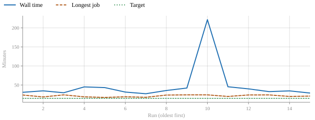
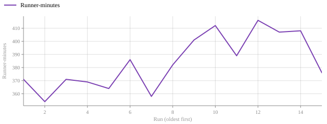
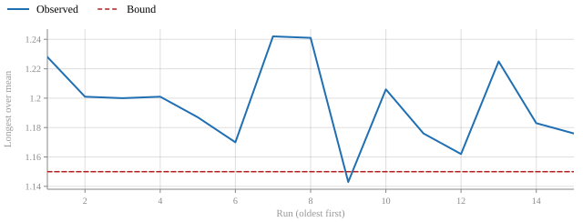
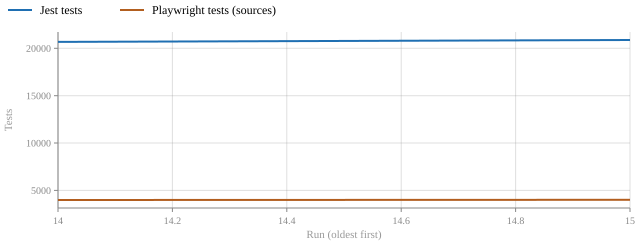

# CI cost and test-runtime trends

<!-- Generated by `node tools/observability.mjs page`; do not edit. The history is carried at the end of this file. -->

Each run of `.github/workflows/ci.yml` leaves one record (`tools/observability.mjs collect`, written by the `ci-cost` job as the `ci-observability` artifact). The records are not tracked; this page is their trend, drawn with the plot component's static export (`js/plot/export.js`), and it carries its own data so `node tools/observability.mjs page --check` can say whether it is current. Prompt 292 (`DECISION_REGISTER.md`, D-R10-292-01 to -08) made it; Prompt 145 set a 15-minute target (D-R10-01), which Carl reset to 22 minutes on 2026-11-12 (D-R10-292-11).

## The target

Aggregate CI at or under 22 minutes (run created to last job completed) over 10 green runs, with the test counts at or above the baseline.

| Measure | Value |
| --- | --- |
| Green runs counted, since the 17-shard matrix | 1 of 10 |
| Median wall time | 28.9 min |
| Slowest wall time | 28.9 min |
| Median runner-minutes | 376 |
| Baseline: the 10 green runs before it | median 39.9 min wall (slowest 221.5), 389 runner-minutes |
| Jest tests, first record with counts to latest | 20677 to 20879 |
| Verdict | NOT YET MET (1 runs counted; the median is 28.9 min) |

## The latest run

| Run | Commit | Event | Result | Jobs | Queue | Wall | Runner-minutes | Longest job |
| --- | --- | --- | --- | ---: | ---: | ---: | ---: | --- |
| 43169241344 | 59d82585 | push | success | 28 | 2 s | 28.9 min | 376 | Browser smoke tests (sources) 9/17 (21 min) |

Source shards: 17 of them, test step 14.1 to 20.1 min, mean 17.1; longest over mean 1.176 (the planner's committed bound is 1.15).

Counts: Jest 619 suites, 20879 tests, 0 failed; Playwright (sources) 4004 expected, 0 unexpected, 0 retried, 10 skipped.

Flake ledger: 0 quarantined; 0 retried by name; pending acceptance 15 of 15 activated. Policy: D-R10-02: a quarantine needs an owner, an expiry and a named external cause; retries stay at 1.

Budget lines: initial 830 KB, deferred 3125.5 KB; 30 route ceilings; data plane packBytes 355265 of 355282 (ok), packGzipBytes 111422 of 111422 (ok), precacheFirstVisitGzipBytes 5417009 of 5417548 (ok), precacheIdleGzipBytes 1697439 of 1697439 (ok), workerConcurrencyLowEnd 2 of 2 (ok), workerMemoryBytesLowEnd 256000000 of 256000000 (ok), decodedImageBytesPerPage not measured of 67108864 (not measured), indexedDbAndCacheBytes 18508011 of 209715200 (ok).

Job durations in the latest run

| Job | Minutes |
| --- | ---: |
| Browser smoke tests (sources) 9/17 | 21 |
| Browser smoke tests (sources) 17/17 | 21 |
| Browser smoke tests (sources) 5/17 | 20.4 |
| Browser smoke tests (sources) 15/17 | 20.3 |
| Browser smoke tests (sources) 2/17 | 20.3 |
| Browser smoke tests (sources) 6/17 | 19.9 |
| Accessibility (axe + keyboard) | 18.7 |
| Browser smoke tests (sources) 7/17 | 17.5 |
| Browser smoke tests (sources) 1/17 | 17.4 |
| Browser smoke tests (sources) 8/17 | 17.3 |
| Browser smoke tests (sources) 14/17 | 17 |
| Browser smoke tests (sources) 16/17 | 17 |
| Browser smoke tests (sources) 12/17 | 16.7 |
| Browser smoke tests (sources) 4/17 | 16.7 |
| Browser smoke tests (sources) 3/17 | 16.3 |
| Browser smoke tests (sources) 11/17 | 15.6 |
| Browser smoke tests (sources) 10/17 | 15.6 |
| Browser smoke tests (sources) 13/17 | 14.8 |
| Lint, tests and physics validation | 14 |
| Browser smoke tests (production build) | 10.8 |
| Engine compatibility (webkit) | 8.4 |
| Engine compatibility (firefox) | 4.6 |
| Production build | 0.7 |
| Browser smoke tests (sources) coverage | 0.5 |
| Browser smoke tests (sources) report | 0.4 |
| CI | 0.1 |
| Pull-request class | 0 |
| Record the CI cost | 0 |

## Trends

x is the run, oldest first; the table below names each.

## Runs

| # | Date | Run | Result | Wall (min) | Runner-min | Jest tests | Playwright tests |
| ---: | --- | --- | --- | ---: | ---: | ---: | ---: |
| 1 | 2026-11-10 | 42909096269 | success | 30.9 | 371 |  |  |
| 2 | 2026-11-10 | 42920634313 | success | 34.8 | 354 |  |  |
| 3 | 2026-11-11 | 42930549772 | success | 29.7 | 371 |  |  |
| 4 | 2026-11-11 | 42942310385 | success | 45.1 | 369 |  |  |
| 5 | 2026-11-11 | 42950374371 | success | 43.3 | 364 |  |  |
| 6 | 2026-11-11 | 42957708336 | success | 31.5 | 386 |  |  |
| 7 | 2026-11-11 | 42973038803 | success | 27.1 | 358 |  |  |
| 8 | 2026-11-11 | 42998602266 | failure | 35.6 | 382 |  |  |
| 9 | 2026-11-11 | 43024686803 | success | 42.1 | 401 |  |  |
| 10 | 2026-11-11 | 43033863599 | success | 221.5 | 412 |  |  |
| 11 | 2026-11-11 | 43083006466 | success | 45.5 | 389 |  |  |
| 12 | 2026-11-11 | 43104870921 | success | 39.9 | 416 |  |  |
| 13 | 2026-11-11 | 43118191628 | success | 32.7 | 407 |  |  |
| 14 | 2026-11-12 | 43130707229 | success | 34.6 | 408 | 20677 | 3984 |
| 15 | 2026-11-12 | 43169241344 | success | 28.9 | 376 | 20879 | 4004 |

## What the wall time is made of

Measured on the first run of the 17-shard matrix on v3 (run 43169241344, push, 59d82585; Prompt 292 follow-up, D-R10-292-10): **29.7 minutes** from the run being created to the last job finishing (28.9 by the cost record, which stops at the last gated job), against the original 15-minute target (now 22) and the 21 to 25 the planner predicted. The chain, by job start and end in minutes: the longest source shard 9/17 ran 0.1 to 21.1 (shards 14.8 to 21.0, all under the 24-minute step stop, longest over mean 1.18 against the 1.15 bound); the accessibility job 0.0 to 18.6; Jest 14.0; the production-build job 14.1 to 24.9. The two jobs that gate the shards (the coverage check and the report, 25 seconds each) were created at 21.0 and **started at 28.3: seven minutes waiting for a runner**, because another run on the same pool (a pull request created 40 seconds after this push) held the 20 slots. So 21.1 minutes of tests, 7.2 minutes of runner queue, and about 1.4 for the gate and the cost record. The queue is not a property of this workflow: the pool is shared by every run on the repository. On the same push a first attempt of the accessibility job was cancelled at its 25-minute limit with no failing test (it ran 18.6 to 23.7 minutes on other heads), which is why that job is now two parts.

**Floor.** The runner-minutes (376 to 408 a run) divided by the 20 slots is 19 to 20.4 minutes before any queueing behind another run. A 15-minute pull-request wall time was not reachable by planning. **Carl reset the pull-request target to 22 minutes on 2026-11-12** (D-R10-292-11, on the recommendation of D-R10-292-06), to be judged on runs that did not overlap another: read the gap between a gate job being created and started in the run before blaming the suite.

<!-- ci-observability-history
{"schema":"gravitas.ci-observability/1","run":{"id":42909096269,"sha":"e23dff10","event":"push","conclusion":"success","createdAt":"2026-11-10T21:51:40Z"},"cost":{"jobs":31,"queueSeconds":3,"wallSeconds":1853,"runnerMinutes":371,"longestJob":{"name":"Lint, tests and physics validation","seconds":1427}},"shards":{"shards":20,"minSeconds":680,"maxSeconds":1000,"meanSeconds":815,"spread":1.228},"plan":null,"counts":{"jest":null,"playwright":null},"flakes":{"policy":"D-R10-02: a quarantine needs an owner, an expiry and a named external cause; retries stay at 1","quarantined":[],"retried":[],"pending":{"registered":15,"activated":15}},"budgets":{"ceilingsKb":{"initial":830,"deferred":3125.4},"routes":30,"data":[{"key":"packBytes","measured":355265,"ceiling":355282,"status":"ok"},{"key":"packGzipBytes","measured":111422,"ceiling":111422,"status":"ok"},{"key":"precacheFirstVisitGzipBytes","measured":5415762,"ceiling":5415762,"status":"ok"},{"key":"precacheIdleGzipBytes","measured":1695847,"ceiling":1696781,"status":"ok"},{"key":"workerConcurrencyLowEnd","measured":2,"ceiling":2,"status":"ok"},{"key":"workerMemoryBytesLowEnd","measured":256000000,"ceiling":256000000,"status":"ok"},{"key":"decodedImageBytesPerPage","measured":null,"ceiling":67108864,"status":"not measured"},{"key":"indexedDbAndCacheBytes","measured":18508011,"ceiling":209715200,"status":"ok"}]}}
{"schema":"gravitas.ci-observability/1","run":{"id":42920634313,"sha":"fb88c133","event":"push","conclusion":"success","createdAt":"2026-11-10T23:07:15Z"},"cost":{"jobs":31,"queueSeconds":2,"wallSeconds":2086,"runnerMinutes":354,"longestJob":{"name":"Lint, tests and physics validation","seconds":1129}},"shards":{"shards":20,"minSeconds":652,"maxSeconds":957,"meanSeconds":797,"spread":1.201},"plan":null,"counts":{"jest":null,"playwright":null},"flakes":{"policy":"D-R10-02: a quarantine needs an owner, an expiry and a named external cause; retries stay at 1","quarantined":[],"retried":[],"pending":{"registered":15,"activated":15}},"budgets":{"ceilingsKb":{"initial":830,"deferred":3125.4},"routes":30,"data":[{"key":"packBytes","measured":355265,"ceiling":355282,"status":"ok"},{"key":"packGzipBytes","measured":111422,"ceiling":111422,"status":"ok"},{"key":"precacheFirstVisitGzipBytes","measured":5415762,"ceiling":5415762,"status":"ok"},{"key":"precacheIdleGzipBytes","measured":1695847,"ceiling":1696781,"status":"ok"},{"key":"workerConcurrencyLowEnd","measured":2,"ceiling":2,"status":"ok"},{"key":"workerMemoryBytesLowEnd","measured":256000000,"ceiling":256000000,"status":"ok"},{"key":"decodedImageBytesPerPage","measured":null,"ceiling":67108864,"status":"not measured"},{"key":"indexedDbAndCacheBytes","measured":18508011,"ceiling":209715200,"status":"ok"}]}}
{"schema":"gravitas.ci-observability/1","run":{"id":42930549772,"sha":"732c1b65","event":"push","conclusion":"success","createdAt":"2026-11-11T00:20:21Z"},"cost":{"jobs":31,"queueSeconds":2,"wallSeconds":1780,"runnerMinutes":371,"longestJob":{"name":"Lint, tests and physics validation","seconds":1446}},"shards":{"shards":20,"minSeconds":611,"maxSeconds":989,"meanSeconds":824,"spread":1.2},"plan":null,"counts":{"jest":null,"playwright":null},"flakes":{"policy":"D-R10-02: a quarantine needs an owner, an expiry and a named external cause; retries stay at 1","quarantined":[],"retried":[],"pending":{"registered":15,"activated":15}},"budgets":{"ceilingsKb":{"initial":830,"deferred":3125.4},"routes":30,"data":[{"key":"packBytes","measured":355265,"ceiling":355282,"status":"ok"},{"key":"packGzipBytes","measured":111422,"ceiling":111422,"status":"ok"},{"key":"precacheFirstVisitGzipBytes","measured":5415762,"ceiling":5415762,"status":"ok"},{"key":"precacheIdleGzipBytes","measured":1695847,"ceiling":1696781,"status":"ok"},{"key":"workerConcurrencyLowEnd","measured":2,"ceiling":2,"status":"ok"},{"key":"workerMemoryBytesLowEnd","measured":256000000,"ceiling":256000000,"status":"ok"},{"key":"decodedImageBytesPerPage","measured":null,"ceiling":67108864,"status":"not measured"},{"key":"indexedDbAndCacheBytes","measured":18508011,"ceiling":209715200,"status":"ok"}]}}
{"schema":"gravitas.ci-observability/1","run":{"id":42942310385,"sha":"0d41713f","event":"push","conclusion":"success","createdAt":"2026-11-11T01:54:45Z"},"cost":{"jobs":31,"queueSeconds":398,"wallSeconds":2703,"runnerMinutes":369,"longestJob":{"name":"Lint, tests and physics validation","seconds":1142}},"shards":{"shards":20,"minSeconds":640,"maxSeconds":1004,"meanSeconds":836,"spread":1.201},"plan":null,"counts":{"jest":null,"playwright":null},"flakes":{"policy":"D-R10-02: a quarantine needs an owner, an expiry and a named external cause; retries stay at 1","quarantined":[],"retried":[],"pending":{"registered":15,"activated":15}},"budgets":{"ceilingsKb":{"initial":830,"deferred":3125.4},"routes":30,"data":[{"key":"packBytes","measured":355265,"ceiling":355282,"status":"ok"},{"key":"packGzipBytes","measured":111422,"ceiling":111422,"status":"ok"},{"key":"precacheFirstVisitGzipBytes","measured":5415762,"ceiling":5415762,"status":"ok"},{"key":"precacheIdleGzipBytes","measured":1695847,"ceiling":1696781,"status":"ok"},{"key":"workerConcurrencyLowEnd","measured":2,"ceiling":2,"status":"ok"},{"key":"workerMemoryBytesLowEnd","measured":256000000,"ceiling":256000000,"status":"ok"},{"key":"decodedImageBytesPerPage","measured":null,"ceiling":67108864,"status":"not measured"},{"key":"indexedDbAndCacheBytes","measured":18508011,"ceiling":209715200,"status":"ok"}]}}
{"schema":"gravitas.ci-observability/1","run":{"id":42950374371,"sha":"035373f0","event":"push","conclusion":"success","createdAt":"2026-11-11T03:05:18Z"},"cost":{"jobs":31,"queueSeconds":112,"wallSeconds":2596,"runnerMinutes":364,"longestJob":{"name":"Browser smoke tests (sources) 2/20","seconds":1044}},"shards":{"shards":20,"minSeconds":671,"maxSeconds":989,"meanSeconds":833,"spread":1.187},"plan":null,"counts":{"jest":null,"playwright":null},"flakes":{"policy":"D-R10-02: a quarantine needs an owner, an expiry and a named external cause; retries stay at 1","quarantined":[],"retried":[],"pending":{"registered":15,"activated":15}},"budgets":{"ceilingsKb":{"initial":830,"deferred":3125.4},"routes":30,"data":[{"key":"packBytes","measured":355265,"ceiling":355282,"status":"ok"},{"key":"packGzipBytes","measured":111422,"ceiling":111422,"status":"ok"},{"key":"precacheFirstVisitGzipBytes","measured":5415762,"ceiling":5415762,"status":"ok"},{"key":"precacheIdleGzipBytes","measured":1695847,"ceiling":1696781,"status":"ok"},{"key":"workerConcurrencyLowEnd","measured":2,"ceiling":2,"status":"ok"},{"key":"workerMemoryBytesLowEnd","measured":256000000,"ceiling":256000000,"status":"ok"},{"key":"decodedImageBytesPerPage","measured":null,"ceiling":67108864,"status":"not measured"},{"key":"indexedDbAndCacheBytes","measured":18508011,"ceiling":209715200,"status":"ok"}]}}
{"schema":"gravitas.ci-observability/1","run":{"id":42957708336,"sha":"3b5cb1ff","event":"push","conclusion":"success","createdAt":"2026-11-11T04:12:28Z"},"cost":{"jobs":31,"queueSeconds":3,"wallSeconds":1889,"runnerMinutes":386,"longestJob":{"name":"Lint, tests and physics validation","seconds":1143}},"shards":{"shards":20,"minSeconds":707,"maxSeconds":1020,"meanSeconds":871,"spread":1.17},"plan":null,"counts":{"jest":null,"playwright":null},"flakes":{"policy":"D-R10-02: a quarantine needs an owner, an expiry and a named external cause; retries stay at 1","quarantined":[],"retried":[],"pending":{"registered":15,"activated":15}},"budgets":{"ceilingsKb":{"initial":830,"deferred":3125.4},"routes":30,"data":[{"key":"packBytes","measured":355265,"ceiling":355282,"status":"ok"},{"key":"packGzipBytes","measured":111422,"ceiling":111422,"status":"ok"},{"key":"precacheFirstVisitGzipBytes","measured":5415762,"ceiling":5415762,"status":"ok"},{"key":"precacheIdleGzipBytes","measured":1695847,"ceiling":1696781,"status":"ok"},{"key":"workerConcurrencyLowEnd","measured":2,"ceiling":2,"status":"ok"},{"key":"workerMemoryBytesLowEnd","measured":256000000,"ceiling":256000000,"status":"ok"},{"key":"decodedImageBytesPerPage","measured":null,"ceiling":67108864,"status":"not measured"},{"key":"indexedDbAndCacheBytes","measured":18508011,"ceiling":209715200,"status":"ok"}]}}
{"schema":"gravitas.ci-observability/1","run":{"id":42973038803,"sha":"ecc6fb5a","event":"push","conclusion":"success","createdAt":"2026-11-11T06:31:33Z"},"cost":{"jobs":31,"queueSeconds":2,"wallSeconds":1624,"runnerMinutes":358,"longestJob":{"name":"Browser smoke tests (sources) 18/20","seconds":1075}},"shards":{"shards":20,"minSeconds":632,"maxSeconds":1029,"meanSeconds":828,"spread":1.242},"plan":null,"counts":{"jest":null,"playwright":null},"flakes":{"policy":"D-R10-02: a quarantine needs an owner, an expiry and a named external cause; retries stay at 1","quarantined":[],"retried":[],"pending":{"registered":15,"activated":15}},"budgets":{"ceilingsKb":{"initial":830,"deferred":3125.4},"routes":30,"data":[{"key":"packBytes","measured":355265,"ceiling":355282,"status":"ok"},{"key":"packGzipBytes","measured":111422,"ceiling":111422,"status":"ok"},{"key":"precacheFirstVisitGzipBytes","measured":5415762,"ceiling":5415762,"status":"ok"},{"key":"precacheIdleGzipBytes","measured":1695847,"ceiling":1696781,"status":"ok"},{"key":"workerConcurrencyLowEnd","measured":2,"ceiling":2,"status":"ok"},{"key":"workerMemoryBytesLowEnd","measured":256000000,"ceiling":256000000,"status":"ok"},{"key":"decodedImageBytesPerPage","measured":null,"ceiling":67108864,"status":"not measured"},{"key":"indexedDbAndCacheBytes","measured":18508011,"ceiling":209715200,"status":"ok"}]}}
{"schema":"gravitas.ci-observability/1","run":{"id":42998602266,"sha":"fa6604eb","event":"push","conclusion":"failure","createdAt":"2026-11-11T09:50:51Z"},"cost":{"jobs":31,"queueSeconds":3,"wallSeconds":2133,"runnerMinutes":382,"longestJob":{"name":"Lint, tests and physics validation","seconds":1421}},"shards":{"shards":20,"minSeconds":644,"maxSeconds":1065,"meanSeconds":858,"spread":1.241},"plan":null,"counts":{"jest":null,"playwright":null},"flakes":{"policy":"D-R10-02: a quarantine needs an owner, an expiry and a named external cause; retries stay at 1","quarantined":[],"retried":[],"pending":{"registered":15,"activated":15}},"budgets":{"ceilingsKb":{"initial":830,"deferred":3125.4},"routes":30,"data":[{"key":"packBytes","measured":355265,"ceiling":355282,"status":"ok"},{"key":"packGzipBytes","measured":111422,"ceiling":111422,"status":"ok"},{"key":"precacheFirstVisitGzipBytes","measured":5415762,"ceiling":5415762,"status":"ok"},{"key":"precacheIdleGzipBytes","measured":1695847,"ceiling":1696781,"status":"ok"},{"key":"workerConcurrencyLowEnd","measured":2,"ceiling":2,"status":"ok"},{"key":"workerMemoryBytesLowEnd","measured":256000000,"ceiling":256000000,"status":"ok"},{"key":"decodedImageBytesPerPage","measured":null,"ceiling":67108864,"status":"not measured"},{"key":"indexedDbAndCacheBytes","measured":18508011,"ceiling":209715200,"status":"ok"}]}}
{"schema":"gravitas.ci-observability/1","run":{"id":43024686803,"sha":"534b7473","event":"push","conclusion":"success","createdAt":"2026-11-11T12:56:33Z"},"cost":{"jobs":31,"queueSeconds":2,"wallSeconds":2523,"runnerMinutes":401,"longestJob":{"name":"Lint, tests and physics validation","seconds":1443}},"shards":{"shards":20,"minSeconds":666,"maxSeconds":1034,"meanSeconds":905,"spread":1.143},"plan":null,"counts":{"jest":null,"playwright":null},"flakes":{"policy":"D-R10-02: a quarantine needs an owner, an expiry and a named external cause; retries stay at 1","quarantined":[],"retried":[],"pending":{"registered":15,"activated":15}},"budgets":{"ceilingsKb":{"initial":830,"deferred":3125.4},"routes":30,"data":[{"key":"packBytes","measured":355265,"ceiling":355282,"status":"ok"},{"key":"packGzipBytes","measured":111422,"ceiling":111422,"status":"ok"},{"key":"precacheFirstVisitGzipBytes","measured":5415762,"ceiling":5415762,"status":"ok"},{"key":"precacheIdleGzipBytes","measured":1695847,"ceiling":1696781,"status":"ok"},{"key":"workerConcurrencyLowEnd","measured":2,"ceiling":2,"status":"ok"},{"key":"workerMemoryBytesLowEnd","measured":256000000,"ceiling":256000000,"status":"ok"},{"key":"decodedImageBytesPerPage","measured":null,"ceiling":67108864,"status":"not measured"},{"key":"indexedDbAndCacheBytes","measured":18508011,"ceiling":209715200,"status":"ok"}]}}
{"schema":"gravitas.ci-observability/1","run":{"id":43033863599,"sha":"7aeab685","event":"push","conclusion":"success","createdAt":"2026-11-11T13:57:30Z"},"cost":{"jobs":31,"queueSeconds":3,"wallSeconds":13292,"runnerMinutes":412,"longestJob":{"name":"Lint, tests and physics validation","seconds":1443}},"shards":{"shards":20,"minSeconds":717,"maxSeconds":1074,"meanSeconds":891,"spread":1.206},"plan":null,"counts":{"jest":null,"playwright":null},"flakes":{"policy":"D-R10-02: a quarantine needs an owner, an expiry and a named external cause; retries stay at 1","quarantined":[],"retried":[],"pending":{"registered":15,"activated":15}},"budgets":{"ceilingsKb":{"initial":830,"deferred":3125.4},"routes":30,"data":[{"key":"packBytes","measured":355265,"ceiling":355282,"status":"ok"},{"key":"packGzipBytes","measured":111422,"ceiling":111422,"status":"ok"},{"key":"precacheFirstVisitGzipBytes","measured":5415762,"ceiling":5415762,"status":"ok"},{"key":"precacheIdleGzipBytes","measured":1695847,"ceiling":1696781,"status":"ok"},{"key":"workerConcurrencyLowEnd","measured":2,"ceiling":2,"status":"ok"},{"key":"workerMemoryBytesLowEnd","measured":256000000,"ceiling":256000000,"status":"ok"},{"key":"decodedImageBytesPerPage","measured":null,"ceiling":67108864,"status":"not measured"},{"key":"indexedDbAndCacheBytes","measured":18508011,"ceiling":209715200,"status":"ok"}]}}
{"schema":"gravitas.ci-observability/1","run":{"id":43083006466,"sha":"66c0e04a","event":"push","conclusion":"success","createdAt":"2026-11-11T18:59:53Z"},"cost":{"jobs":31,"queueSeconds":2,"wallSeconds":2727,"runnerMinutes":389,"longestJob":{"name":"Accessibility (axe + keyboard)","seconds":1201}},"shards":{"shards":20,"minSeconds":689,"maxSeconds":1037,"meanSeconds":882,"spread":1.176},"plan":null,"counts":{"jest":null,"playwright":null},"flakes":{"policy":"D-R10-02: a quarantine needs an owner, an expiry and a named external cause; retries stay at 1","quarantined":[],"retried":[],"pending":{"registered":15,"activated":15}},"budgets":{"ceilingsKb":{"initial":830,"deferred":3125.4},"routes":30,"data":[{"key":"packBytes","measured":355265,"ceiling":355282,"status":"ok"},{"key":"packGzipBytes","measured":111422,"ceiling":111422,"status":"ok"},{"key":"precacheFirstVisitGzipBytes","measured":5415762,"ceiling":5415762,"status":"ok"},{"key":"precacheIdleGzipBytes","measured":1695847,"ceiling":1696781,"status":"ok"},{"key":"workerConcurrencyLowEnd","measured":2,"ceiling":2,"status":"ok"},{"key":"workerMemoryBytesLowEnd","measured":256000000,"ceiling":256000000,"status":"ok"},{"key":"decodedImageBytesPerPage","measured":null,"ceiling":67108864,"status":"not measured"},{"key":"indexedDbAndCacheBytes","measured":18508011,"ceiling":209715200,"status":"ok"}]}}
{"schema":"gravitas.ci-observability/1","run":{"id":43104870921,"sha":"c70f5c2a","event":"push","conclusion":"success","createdAt":"2026-11-11T21:38:46Z"},"cost":{"jobs":31,"queueSeconds":2,"wallSeconds":2392,"runnerMinutes":416,"longestJob":{"name":"Lint, tests and physics validation","seconds":1434}},"shards":{"shards":20,"minSeconds":728,"maxSeconds":1079,"meanSeconds":928,"spread":1.162},"plan":null,"counts":{"jest":null,"playwright":null},"flakes":{"policy":"D-R10-02: a quarantine needs an owner, an expiry and a named external cause; retries stay at 1","quarantined":[],"retried":[],"pending":{"registered":15,"activated":15}},"budgets":{"ceilingsKb":{"initial":830,"deferred":3125.4},"routes":30,"data":[{"key":"packBytes","measured":355265,"ceiling":355282,"status":"ok"},{"key":"packGzipBytes","measured":111422,"ceiling":111422,"status":"ok"},{"key":"precacheFirstVisitGzipBytes","measured":5415762,"ceiling":5415762,"status":"ok"},{"key":"precacheIdleGzipBytes","measured":1695847,"ceiling":1696781,"status":"ok"},{"key":"workerConcurrencyLowEnd","measured":2,"ceiling":2,"status":"ok"},{"key":"workerMemoryBytesLowEnd","measured":256000000,"ceiling":256000000,"status":"ok"},{"key":"decodedImageBytesPerPage","measured":null,"ceiling":67108864,"status":"not measured"},{"key":"indexedDbAndCacheBytes","measured":18508011,"ceiling":209715200,"status":"ok"}]}}
{"schema":"gravitas.ci-observability/1","run":{"id":43118191628,"sha":"b4ac1b70","event":"push","conclusion":"success","createdAt":"2026-11-11T23:13:47Z"},"cost":{"jobs":31,"queueSeconds":2,"wallSeconds":1964,"runnerMinutes":407,"longestJob":{"name":"Accessibility (axe + keyboard)","seconds":1439}},"shards":{"shards":20,"minSeconds":710,"maxSeconds":1121,"meanSeconds":915,"spread":1.225},"plan":null,"counts":{"jest":null,"playwright":null},"flakes":{"policy":"D-R10-02: a quarantine needs an owner, an expiry and a named external cause; retries stay at 1","quarantined":[],"retried":[],"pending":{"registered":15,"activated":15}},"budgets":{"ceilingsKb":{"initial":830,"deferred":3125.4},"routes":30,"data":[{"key":"packBytes","measured":355265,"ceiling":355282,"status":"ok"},{"key":"packGzipBytes","measured":111422,"ceiling":111422,"status":"ok"},{"key":"precacheFirstVisitGzipBytes","measured":5415762,"ceiling":5415762,"status":"ok"},{"key":"precacheIdleGzipBytes","measured":1695847,"ceiling":1696781,"status":"ok"},{"key":"workerConcurrencyLowEnd","measured":2,"ceiling":2,"status":"ok"},{"key":"workerMemoryBytesLowEnd","measured":256000000,"ceiling":256000000,"status":"ok"},{"key":"decodedImageBytesPerPage","measured":null,"ceiling":67108864,"status":"not measured"},{"key":"indexedDbAndCacheBytes","measured":18508011,"ceiling":209715200,"status":"ok"}]}}
{"schema":"gravitas.ci-observability/1","run":{"id":43130707229,"sha":"4c856fa2","event":"push","conclusion":"success","createdAt":"2026-11-12T00:54:21Z"},"cost":{"jobs":31,"queueSeconds":3,"wallSeconds":2077,"runnerMinutes":408,"longestJob":{"name":"Accessibility (axe + keyboard)","seconds":1198}},"shards":{"shards":20,"minSeconds":689,"maxSeconds":1089,"meanSeconds":920,"spread":1.183},"plan":null,"counts":{"jest":{"suites":612,"suitesFailed":0,"tests":20677,"failed":0,"skipped":0,"source":"the documentation fact at v3 4c856fa2 (README.md, jestTests and jestSuites)"},"playwright":{"expected":3983,"unexpected":0,"flaky":1,"skipped":10}},"flakes":{"policy":"D-R10-02: a quarantine needs an owner, an expiry and a named external cause; retries stay at 1","quarantined":[],"retried":["uiCoherence.spec.js > a toast names the type and it reaches the live region"],"pending":{"registered":15,"activated":15}},"budgets":{"ceilingsKb":{"initial":830,"deferred":3125.4},"routes":30,"data":[{"key":"packBytes","measured":355265,"ceiling":355282,"status":"ok"},{"key":"packGzipBytes","measured":111422,"ceiling":111422,"status":"ok"},{"key":"precacheFirstVisitGzipBytes","measured":5415762,"ceiling":5415762,"status":"ok"},{"key":"precacheIdleGzipBytes","measured":1695847,"ceiling":1696781,"status":"ok"},{"key":"workerConcurrencyLowEnd","measured":2,"ceiling":2,"status":"ok"},{"key":"workerMemoryBytesLowEnd","measured":256000000,"ceiling":256000000,"status":"ok"},{"key":"decodedImageBytesPerPage","measured":null,"ceiling":67108864,"status":"not measured"},{"key":"indexedDbAndCacheBytes","measured":18508011,"ceiling":209715200,"status":"ok"}]}}
{"schema":"gravitas.ci-observability/1","run":{"id":43169241344,"sha":"59d82585","event":"push","conclusion":"success","createdAt":"2026-11-12T06:35:54Z"},"cost":{"jobs":28,"queueSeconds":2,"wallSeconds":1732,"runnerMinutes":376,"longestJob":{"name":"Browser smoke tests (sources) 9/17","seconds":1262}},"jobs":{"Browser smoke tests (sources) 9/17":1262,"Browser smoke tests (sources) 17/17":1257,"Browser smoke tests (sources) 5/17":1223,"Browser smoke tests (sources) 15/17":1219,"Browser smoke tests (sources) 2/17":1215,"Browser smoke tests (sources) 6/17":1191,"Accessibility (axe + keyboard)":1119,"Browser smoke tests (sources) 7/17":1049,"Browser smoke tests (sources) 1/17":1043,"Browser smoke tests (sources) 8/17":1040,"Browser smoke tests (sources) 14/17":1018,"Browser smoke tests (sources) 16/17":1018,"Browser smoke tests (sources) 12/17":1003,"Browser smoke tests (sources) 4/17":1001,"Browser smoke tests (sources) 3/17":978,"Browser smoke tests (sources) 11/17":936,"Browser smoke tests (sources) 10/17":933,"Browser smoke tests (sources) 13/17":885,"Lint, tests and physics validation":842,"Browser smoke tests (production build)":647,"Engine compatibility (webkit)":505,"Engine compatibility (firefox)":273,"Production build":39,"Browser smoke tests (sources) coverage":28,"Browser smoke tests (sources) report":24,"CI":4,"Pull-request class":2,"Record the CI cost":0},"shards":{"shards":17,"minSeconds":845,"maxSeconds":1208,"meanSeconds":1028,"spread":1.176},"plan":null,"counts":{"jest":{"suites":619,"suitesFailed":0,"tests":20879,"failed":0,"skipped":0},"playwright":{"expected":4004,"unexpected":0,"flaky":0,"skipped":10}},"flakes":{"policy":"D-R10-02: a quarantine needs an owner, an expiry and a named external cause; retries stay at 1","quarantined":[],"retried":[],"pending":{"registered":15,"activated":15}},"budgets":{"ceilingsKb":{"initial":830,"deferred":3125.5},"routes":30,"data":[{"key":"packBytes","measured":355265,"ceiling":355282,"status":"ok"},{"key":"packGzipBytes","measured":111422,"ceiling":111422,"status":"ok"},{"key":"precacheFirstVisitGzipBytes","measured":5417009,"ceiling":5417548,"status":"ok"},{"key":"precacheIdleGzipBytes","measured":1697439,"ceiling":1697439,"status":"ok"},{"key":"workerConcurrencyLowEnd","measured":2,"ceiling":2,"status":"ok"},{"key":"workerMemoryBytesLowEnd","measured":256000000,"ceiling":256000000,"status":"ok"},{"key":"decodedImageBytesPerPage","measured":null,"ceiling":67108864,"status":"not measured"},{"key":"indexedDbAndCacheBytes","measured":18508011,"ceiling":209715200,"status":"ok"}]}}
-->
